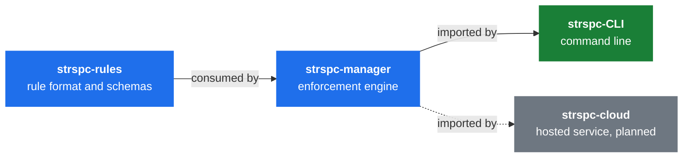
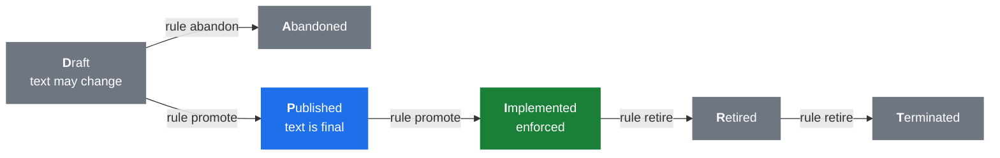

<div align="center">


# SteerSpec CLI

**Author, validate and enforce behavioral rules from the command line.**

[](https://github.com/SteerSpec/strspc-CLI/actions/workflows/ci.yml)
[](https://github.com/SteerSpec/strspc-CLI/releases)
[](go.mod)
[](LICENSE)

[Architecture](#architecture) · [Install](#installation) · [Quick start](#quick-start) ·
[Concepts](#concepts) · [Commands](#commands) · [Author rules](#author-rules) ·
[Configure](#configure-a-project) · [Validate](#validate-rules) · [Check code](#check-code-changes) ·
[Render](#render-rules) · [CI](#continuous-integration) · [Reference](#reference) ·
[Work in progress](#work-in-progress) · [Development](#development) ·
[Releases](#branching-and-releases)

</div>

[SteerSpec](https://steerspec.dev) keeps behavioral rules as structured JSON, next to the code they
govern. `strspc` wraps the [strspc-manager](https://github.com/SteerSpec/strspc-manager) engine: it
writes rule files with valid versions and hashes, validates them and their lifecycle, and asks an AI
evaluator whether a code change complies. Authoring and validation run locally, with no server.

The [Rule Manager specification](https://github.com/SteerSpec/strspc-manager/blob/main/docs/SPEC.md)
(cited below as SPEC) is normative. Its principles shape how the CLI works:

- **JSON is the source of truth.** Markdown is a rendered view.
- **Rules are immutable after Draft.** A change to a later rule is a new rule that supersedes it.
- **Enforcement is AI by default.** Rules are natural language read by an LLM; static checks are an
  optimization.
- **Severity belongs to the consumer.** A project's `fail_on` decides which violations block a merge.

## Architecture



Dependencies point one way, and releases land in the same order. Rule logic lives in the manager;
the CLI presents its results. [strspc-spec](https://github.com/SteerSpec/strspc-spec) holds the rules
that govern these tiers, and this repository owns the `dev.steerspec.cli` realm in [`rules/`](rules)
(`CFG`, `CMD`, `CONV`), which pins `dev.steerspec.core` in [`rules/realm.json`](rules/realm.json).

| Command | Manager modules (SPEC §6.2) |
| ------- | --------------------------- |
| `strspc lint` | `rule-lint` |
| `strspc diff` | `rule-diff` |
| `strspc realm validate` | `realm-lint`, `rule-lint`, `remote` |
| `strspc render` | `rule-render`, plus `realm-resolve` for an entity that declares `inherits` |
| `strspc sync` | `rule-resolve`, `remote` |
| `strspc check` | `rule-resolve`, `realm-resolve`, `remote`, `rule-eval`, `eval-cache` |
| `strspc realm dep upgrade` | `remote`, then the `realm validate` checks |

## Installation

**Homebrew (macOS)**

```bash
brew install --cask SteerSpec/tap/strspc
```

Recent Homebrew versions require trusting a third-party tap before its first install. If brew
refuses, run `brew trust --cask steerspec/tap/strspc` (or `brew trust steerspec/tap`) and retry.

**GitHub Releases**

Download an archive from [Releases](https://github.com/SteerSpec/strspc-CLI/releases). Linux and
macOS builds (amd64, arm64) are `.tar.gz` files. Windows builds (amd64, arm64) are `.zip` files with
`strspc.exe`, which you can put in any directory on your `PATH`. They aren't code-signed, so
SmartScreen may warn on first run.

**GitHub Actions**

The composite action installs a release for the runner and verifies its checksum:

```yaml
- uses: SteerSpec/strspc-CLI/.github/actions/setup-strspc@main
  with:
    version: "1.28.0"       # or "latest" (the default)
- run: strspc version
```

**From source** (Go 1.26+)

```bash
git clone https://github.com/SteerSpec/strspc-CLI.git
cd strspc-CLI
make build    # produces ./strspc
```

Use `make build`: `go install` names the binary `src` after the package directory, and leaves out
the version information.

## Quick start

```bash
# Consume the core rules
strspc init

# Author rules in your own realm, pinned to the core realm
strspc realm init --dir rules --id com.acme.app --title "Acme App" \
  --dependency dev.steerspec.core@1.13.0=github://SteerSpec/strspc-rules@v1.13.0/rules/core
strspc realm add CFG --title "Configuration"
strspc rule add CFG --body "The CLI MUST write a config file." --added-by "@alice"

# Validate them
strspc lint rules/ --strict
strspc realm validate rules/ --recursive --strict

# Evaluate your code: structural checks first, then Claude
strspc check --static-only
ANTHROPIC_API_KEY=... strspc check
```

Add `./rules/` to `.strspc/config.yaml` to [evaluate your own realm](#configure-a-project).

## Concepts

| Concept | What it is |
| ------- | ---------- |
| **Entity** | The unit of organization, one JSON file per top-level entity. Its EUID is 3 to 18 alphanumeric characters, unique within the Realm |
| **Rule** | A single-phrase behavioral constraint on an entity, such as `CFG-001` |
| **Rule set** | All rules of an entity, versioned as a unit, with a Blake3 hash of the file |
| **Note** | An annotation on a rule, such as a rationale or an example |
| **Realm** | A namespace of entities in a directory with a `realm.json` manifest and `_schema/`. Its ID is in reverse domain notation (`com.acme.app`) |
| **Configuration** | A project's `.strspc/config.yaml`: the rules it consumes and how they are enforced |

See SPEC [§2](https://github.com/SteerSpec/strspc-manager/blob/main/docs/SPEC.md#2-data-model) for the
full data model.

## Commands

| Command | Description |
| ------- | ----------- |
| `strspc init` | Bootstrap `.strspc/config.yaml` and `.strspc/.gitignore` in a project |
| `strspc ci init` | Write the GitHub Actions workflow (and config) that runs SteerSpec in CI |
| `strspc lint` | Validate entity files against schema and rule constraints |
| `strspc diff` | Validate rule lifecycle transitions between a git ref and the working tree |
| `strspc check` | Evaluate a code diff against the rules in `.strspc/config.yaml` |
| `strspc refs` | Validate rule citations in Markdown and other text files |
| `strspc explain` | Explain a diagnostic code, or list all of them with `--list` |
| `strspc sync` | Resolve and cache the rule sources in `.strspc/config.yaml` |
| `strspc render` | Convert entity JSON files to Markdown or normalized JSON |
| `strspc realm init` | Scaffold a new Realm directory |
| `strspc realm add` | Add a new entity to a Realm |
| `strspc realm add-subrealm` | Scaffold a sub-realm inside an existing Realm |
| `strspc realm dep add\|remove\|list\|upgrade` | Manage Realm dependencies |
| `strspc realm validate` | Validate Realm structure and EUID uniqueness |
| `strspc rule add` | Add a Draft rule to an entity or sub-entity |
| `strspc rule update` | Edit the body of a Draft rule |
| `strspc rule promote` | Advance a rule D→P or P→I |
| `strspc rule retire` | Move a rule I→R or R→T |
| `strspc rule abandon` | Abandon a Draft rule (D→A) |
| `strspc rule supersede` | Create a Draft rule that supersedes a P, I or R rule |
| `strspc note add` | Attach a typed note to a rule |
| `strspc note update` | Revise a note in place; notes are never removed |
| `strspc entity add` | Add a sub-entity under an existing entity |
| `strspc entity rehash` | Recompute null or stale `rule_set.hash` values |
| `strspc completion` | Generate a shell completion script (bash, fish, powershell, zsh) |
| `strspc version` | Show version, commit and build info |

Run `strspc <command> --help` for every flag. Commands that edit rules take `--json`, and `--dir`
defaults to `./rules`.

## Author rules

Author rules through the CLI, which keeps versions and hashes valid. Don't edit entity JSON by hand.



Transitions are forward-only and no state may be skipped
([SPEC §3](https://github.com/SteerSpec/strspc-manager/blob/main/docs/SPEC.md#3-rule-lifecycle)).
Every change bumps the rule set version: minor when a rule is promoted or retired, patch otherwise.

```bash
strspc rule add CFG --body "The CLI MUST write a config file." --added-by "@alice"
strspc rule update CFG-001 --body "The CLI MUST write a YAML config file."     # Draft only
strspc rule promote CFG-001                                                    # D → P
strspc note add CFG-001 --type rationale --body "Why." --added-by "@alice"
strspc note update CFG-001/01 --body "Corrected."
strspc entity add CFGIO --parent CFG --title "Config I/O"
strspc rule add CFG --sub-entity CFGIO --body "Writes MUST be atomic." --added-by "@alice"
strspc entity rehash --all                                     # fix hashes after a bulk import
```

**Sub-entities.** Rule commands accept a sub-entity EUID anywhere a top-level EUID is accepted: the
CLI scans `sub_entities[]` of every entity file under `--dir` and refreshes the parent hash.

**Superseding.** Rules that have left Draft are immutable, so `rule supersede` creates a Draft that
replaces them. It leaves the original unchanged: when the new rule reaches Implemented, the old one
must be Retired, or `strspc diff` warns (`RD006`). `rule retire` moves a rule from Implemented to
Retired, so promote a Published rule first. A rule that's already Retired needs nothing.

**Notes.** Types are `rationale`, `example`, `counter_example`, `reference`, `applies_to`, `changelog`,
`clarification`, `deprecation_notice`, `supersedes`, `extends` and `related`. A note can be revised
but never removed. `changelog`, `supersedes`, `extends` and `related` notes can't change once added.

**Inheritance.** An entity can inherit another entity's rule set, in the same Realm or in a declared
dependency, and a rule can override one inherited rule for that entity:

```bash
strspc realm add SAVACCT --title "Savings Account" --inherits dev.globalbank.core:ACCT
strspc rule add SAVACCT --body "Withdrawals MUST be capped." --added-by "@alice" \
  --overrides dev.globalbank.core:ACCT-005 # strspc-refs: ignore
```

`entity add` also takes `--inherits`, and `rule supersede` takes `--overrides` to keep an override in
force on the replacement rule.

### Realms and dependencies

`strspc realm init` creates `realm.json` and vendors the schemas in `_schema/`
([SPEC §2.8](https://github.com/SteerSpec/strspc-manager/blob/main/docs/SPEC.md#28-realm)). Non-core
realms should depend on `dev.steerspec.core`, as in the [quick start](#quick-start).

```bash
strspc realm dep add com.acme.shared@1.0.0=../shared
strspc realm dep list
strspc realm dep remove com.acme.shared
strspc realm add-subrealm --parent-dir rules --dir rules/sync --id com.acme.app.sync --title "Sync"
```

A sub-realm inherits its parent's dependencies unless you pass `--no-inherit-deps`. `add-subrealm`
doesn't declare it in the parent: add the directory name to `sub_realms` in the parent's `realm.json`,
or `realm validate --recursive` skips it.

**Keep dependencies current.** Dependabot and Renovate can't read `realm.json`, so a pinned dependency
drifts silently. `strspc realm dep upgrade` moves each `github://` dependency pinned to a release tag
to the latest release of its repository, rewrites `version` and the `@vX.Y.Z` in `source`, then
validates the realm (strict, recursive).

```bash
strspc realm dep upgrade --check    # exit 1 if an upgrade is available; writes nothing
strspc realm dep upgrade            # upgrade every dependency
strspc realm dep upgrade dev.steerspec.core --to X.Y.Z
```

If the new version breaks the realm, `realm.json` is restored and the command exits non-zero.
Dependencies are never downgraded. Sources that aren't `github://` references, and those on `@latest`,
a branch or a commit SHA, are skipped. See [GitHub sources](#github-sources) for private repositories.

## Configure a project

`strspc init` writes `.strspc/config.yaml` and a `.strspc/.gitignore` that keeps `cache.db` and
`cache/` out of version control. Pass `--provider null` for an offline setup without an API key, and
`--force` to overwrite. This example adds a local realm to the generated config
([SPEC §2.9](https://github.com/SteerSpec/strspc-manager/blob/main/docs/SPEC.md#29-configuration)):

```yaml
rules:
  - source: github://SteerSpec/strspc-rules@v1.13.0/rules/core   # bumped per rules release
    scope: global
  - source: ./rules/
    scope: global
evaluator:
  provider: claude          # requires ANTHROPIC_API_KEY; use "null" to skip AI evaluation
  model: claude-sonnet-5-5  # the default
  effort: medium            # low | medium | high
cache:
  ttl: 24h
evaluate_on: [D, P, I]      # the default
fail_on:
  - I                       # state codes (D, A, P, I, R, T), not words
```

| Field | Meaning |
| ----- | ------- |
| `rules[].source` | A local directory or a [`github://` reference](#github-sources). At least one is required (SPCFG-004) |
| `rules[].scope` | `global` applies to the whole repository, `local` only to files under the source's own directory |
| `evaluator.provider` | `claude`, or `null` for structural checks only (`static` and `static-only` are aliases). `openai` and `ollama` are reserved and fail with a not-implemented error |
| `evaluator.endpoint` | Provider endpoint, subject to [endpoint safety](#safety-and-configuration-checks) |
| `evaluator.model`, `evaluator.effort` | Model and reasoning effort passed to the provider |
| `cache.ttl` | How long evaluations and `@latest` lookups stay valid |
| `evaluate_on` | Rule states sent to the evaluator; other states are skipped |
| `fail_on` | Rule states whose violations fail the check; other violations are warnings |

> [!TIP]
> Use `scope: global` for a local realm that governs your code, as the CLI's
> [own config](.strspc/config.yaml) does. `strspc realm init` suggests `scope: local`, which limits
> the rules to files under `rules/`, and those are never evaluated.

## Validate rules

```bash
strspc lint rules/ --strict                    # schema and structure of each entity file
strspc realm validate rules/ --recursive       # manifest, EUID uniqueness, sub-realms, pins
strspc diff rules/ --base origin/develop       # lifecycle transitions vs. a git ref
strspc diff rules/ --pr 42                     # ... or vs. a PR base (needs gh auth)
strspc check --static-only                     # resolve sources, verify hashes and references
```

These implement the checks of
[SPEC §7](https://github.com/SteerSpec/strspc-manager/blob/main/docs/SPEC.md#7-cicd-workflows). All
but `check` take `--strict`, which treats warnings as errors, and `--json`. `lint --cross-ref` adds
cross-file reference checks in directory mode. `diff` exits 0 when all checks pass and 1 on a
violation.

**Schemas.** `lint` and `realm validate` use the schemas of the `dev.steerspec.core` version the realm
pins, so a schema change reaches a realm when it bumps its pin. A realm with no pin uses the latest
published schemas, and a realm's own `_schema/` never decides validation. `lint` reads the pin from
`realm.json` in the directory it's given, or in the file's directory.

**Dependencies.** `realm validate` compares the realm with the dependencies it pins, so it fetches them
and needs network access unless they're cached. It reports a pin that disagrees with its source tag or
the dependency's manifest, and a `_schema/` file that differs from the pinned `dev.steerspec.core`.

**Core realm.** The core realm defines the schemas, so it has nothing to pin. Pass `--core` to validate
it against its own `_schema/`:

```bash
strspc realm validate rules/core --recursive --strict --core
strspc lint rules/core --strict --core
```

### Validate rule citations

`strspc refs` checks the rule identifiers that text files cite, such as agent prompts, READMEs and
docs, against the rules in `.strspc/config.yaml` and the realm dependencies they pin:

```bash
strspc refs                                    # Markdown files, ignoring what .gitignore ignores
strspc refs docs .claude --strict              # only these directories; warnings fail
strspc refs --include '*.yml' --exclude 'docs/archive/**'
strspc refs --ignore SHA-256 --allow-state R,T # strspc-refs: ignore
strspc refs --format github                    # annotations; --json for diagnostics as JSON
```

| Code | Cited rule | Default | `--strict` |
| ---- | ---------- | ------- | ---------- |
| RF001 | Doesn't exist, or names a realm that isn't a dependency | error | error |
| RF002 | Abandoned | error | error |
| RF003 | Retired or Terminated, whether or not a rule replaces it | warning | error |
| RF004 | Draft, Published or Implemented, replaced by a rule in I, R or T | error | error |
| RF005 | Draft, Published or Implemented, replaced by a Published rule | warning | error |
| RF006 | Draft | warning | error |

The stored `<EUID>-<NNN>` form always matches, in text or code spans, and so does the realm's own
rendered form. An unknown prefix is reported only when it is uppercase and starts with a letter, so
<!-- strspc-refs: ignore -->
`CLAMS-001` is reported and `feat-123` isn't. `SHA-256` has that shape too, so pass it to `--ignore`.
URLs are skipped.

A line holding `strspc-refs: ignore` exempts itself and the next line, for a historical mention. Any
comment syntax can carry it:

```markdown
<!-- strspc-refs: ignore -->
RUL-004 was retired in 2026.
```

`.strspc/` and `CHANGELOG.md` are always skipped. A pattern with no slash matches a file name in any
directory, and `dir/**` matches everything under `dir`. A file named as an argument is scanned
whatever its extension. `refs` exits 0 when clean, 1 on findings and 2 on a configuration or
resolution error.

## Understand a diagnostic

```bash
strspc explain RM006                         # what a code means and how to fix it
strspc explain --list                        # every code, with its title
strspc lint rules/ --explain                 # explain findings as they are reported
```

`--explain` works on `lint`, `diff`, `realm validate` and `check`. Text output explains each code once,
under its first occurrence. JSON output adds an `explanation` object to every diagnostic.
`strspc check --format github` rejects the flag, because annotations cannot carry the text.

## Check code changes

`strspc check` resolves the configured rule sources, collects a unified diff, and asks the AI provider
for one verdict per rule: `compliant`, `violated` or `not_applicable`. Violations of rules in a
`fail_on` state fail the check; other violations are warnings.

```bash
strspc check                                 # working tree vs HEAD
strspc check --staged                        # index vs HEAD (pre-commit)
strspc check --base origin/develop           # merge base of origin/develop and HEAD vs working tree
strspc check --pr 42                         # same, with the PR base resolved through gh
strspc check --diff-file change.diff         # evaluate a diff produced elsewhere
strspc check --static-only                   # no AI call (RE003)
strspc check --format github                 # ::error/::warning annotations + $GITHUB_STEP_SUMMARY
```

| Flag | Description |
| ---- | ----------- |
| `--base <ref>` | Diff the working tree against the merge base of `<ref>` and HEAD |
| `--staged` | Diff the index against HEAD |
| `--pr <n>` | Diff against the base of GitHub PR `n` (needs the `gh` CLI) |
| `--diff-file <path>` | Read a unified diff from a file, with repository-relative paths as `git diff` prints them |
| `--format human\|json\|github` | Output style; `github` emits annotations and appends a table to `$GITHUB_STEP_SUMMARY` |
| `--provider`, `--model` | Override `evaluator.provider` and `evaluator.model` |
| `--endpoint <url>` | Provider endpoint; needed to opt in to a non-Anthropic host |
| `--static-only` | Skip AI evaluation (also implied by `evaluator.provider: null`) |
| `--no-cache` | Don't read or write `.strspc/cache.db` |
| `--verbose` | Print resolution, diff, cache and token-usage details to stderr |

Diff selection precedence: `--diff-file` > `--staged` > `--pr` > `--base` > `$GITHUB_BASE_REF`
(`origin/<ref>`, fetched when missing) > working tree vs HEAD. Files under `.strspc/` and `rules/` are
never evaluated. The check only writes inside `.strspc/` (`cache/`, `cache.db`).

| Exit code | Meaning |
| --------- | ------- |
| `0` | No violation of a rule in a `fail_on` state (warnings may have been reported) |
| `1` | At least one rule in a `fail_on` state was violated |
| `2` | Configuration (empty `rules:`, unknown state code or provider, unsafe endpoint), rule resolution or diff collection failed |
| `3` | AI provider unavailable: no `ANTHROPIC_API_KEY`, rejected credentials (401/403), unreachable endpoint, or every request failed (a key without workspace scope, a rejected schema) |

### How evaluation works

The flow follows
[SPEC §8.3](https://github.com/SteerSpec/strspc-manager/blob/main/docs/SPEC.md#83-evaluation-flow):

1. Resolve the rule sources and collect the rules in `evaluate_on` states.
2. Collect the diff. An empty diff ends evaluation with `RE004`.
3. Look each rule up in the cache, and send only the misses, one request per owning entity.
4. Get one verdict per rule, then re-read the diff for each violated rule to confirm it or withdraw it.
5. Report the results. A provider failure for a rule is warning `RE002`, which doesn't block on its own.

Only Claude is implemented. With provider `claude` and no key the check exits 3 rather than falling
back, so pass `--static-only` for structural checks. Cached verdicts expire after `cache.ttl`, and
changing a rule, its notes, the diff or the model invalidates them.

### Inheritance and references

An entity with `inherits` is evaluated on its effective rule set: the rules it inherits, minus those
replaced by its own rules in `evaluate_on`, plus its own, so `rule_count` includes inherited rules.
The check resolves the chain of every entity of a source that has a `realm.json`. These fail with
exit 2, also with `--static-only`:

| Code | Failure |
| ---- | ------- |
| `RR013` | An `inherits` target can't be resolved |
| `RR014` | An inheritance chain is cyclic or over 3 hops |
| `RR015` | An `overrides` target isn't inherited |
| `RR017` | A `supersedes`, `extends` or `related` note of a live rule names a Realm that isn't declared |
| `RR018` | Such a note names a known Realm that holds no such rule |

These are warnings:

| Code | Warning |
| ---- | ------- |
| `RR016` | An overridden rule isn't Published or Implemented, so the override has no effect |
| `RR019` | A note or a rule body names a rule that isn't live |
| `RR020` | A rule body names a Realm that isn't declared |
| `RR021` | A rule body names a rule its Realm doesn't hold |
| `CHK003` | An entity declares `inherits` in a source without a `realm.json`, so its inherited rules aren't evaluated |

`strspc realm validate` doesn't run these checks. Rules named in an `extends` note are sent to the
evaluator with the rule that extends them, one hop only, so that rule is read in full; the verdict is
still for that rule alone.

### Safety and configuration checks

**Configuration.** Before resolving any source, the check exits 2 on an empty `rules:` list, an unknown
lifecycle state in `fail_on` or `evaluate_on`, or an unknown `evaluator.provider`. It then validates the
config against the published `config.v1` schema, cached under `.strspc/cache/schemas/`. Each mismatch
is warning `CHK002` and never fails the check on its own. Examples are an unknown key, a long state
name such as `implemented` (accepted, but the schema wants the code), and `effort: xhigh` or `max`
(accepted by the Claude provider, but not by the schema). When the schema can't be fetched, this
validation is skipped and `--verbose` says so.

**Endpoint safety.** `.strspc/config.yaml` is repository content, so a pull request could point
`evaluator.endpoint` at a host that would receive your `ANTHROPIC_API_KEY`. The check accepts an
endpoint from the config only when it's an `https://` URL on `anthropic.com`. Any other endpoint must
be opted in from outside the repository, with `STRSPC_EVALUATOR_ENDPOINT=<url>` (highest precedence) or
`--endpoint <url>`. Without that, it exits 2 with a message naming the host.

## Render rules

```bash
strspc render rules/CFG.json                        # single file to stdout
strspc render rules/ -o docs/                       # directory to docs/ (default: alongside the source)
strspc render rules/CFG.json --json                 # normalized JSON for tooling pipelines
strspc render rules/CFG.json --template my.md.tmpl  # custom Go template
```

Rule identifiers follow the `rule_identifier_format` of the realm that owns the entity file (the
nearest `realm.json`; for a sub-realm, its parent's format). Without one, the RLIFRMT defaults apply,
as in `[ENT-001.0/D]`. Only the rendered form changes, never the stored ID
([SPEC §4](https://github.com/SteerSpec/strspc-manager/blob/main/docs/SPEC.md#4-rule-identifier-format)).

An entity that declares `inherits` gets an "Inherited rules" section listing the rules it inherits,
with their owner and state, and which of its own rules overrides them. `--json` adds them as an
`inherited` array, each entry naming the inheriting entity in `inherited_by`, also for sub-entities;
the array is empty when the chain resolved but nothing is inherited yet, and absent without a chain.
Only such a file makes `render` run realm-resolve, which can download `github://` dependencies into
`.strspc/cache/`. A chain that doesn't resolve is a warning and the entity renders without the section;
`strspc check` is what fails on it.

## Continuous integration

`strspc ci init` writes the workflow for the repository it runs in:

```bash
strspc ci init            # realm repo → lint workflow; other repos → check workflow + config
strspc ci init --dry-run  # print the files instead of writing them
```

- **Realm repo** (has `rules/realm.json`): `.github/workflows/strspc-lint.yml` validates the realm,
  lints entities and checks lifecycle transitions on pull requests, in strict mode.
- **Consumer repo**: `.strspc/config.yaml` plus `.github/workflows/strspc-check.yml`. Without an
  `ANTHROPIC_API_KEY` secret the job runs structural checks only.
- Workflows run for the repository's default branch (from `origin/HEAD`, else `main`); pass `--branch`
  to override, or `--kind realm|consumer` to override the detection.
- `--rules-source` points a consumer at your realm. If it's a private GitHub repository, add a
  `STRSPC_GITHUB_TOKEN` repository secret with read access to it.
- Workflows install the latest `strspc`. Pass `--cli-version X.Y.Z` to pin one, and `--workflow-ref` to
  pin another ref of `SteerSpec/.github`.
- If a file exists, including a config from `strspc init`, the command exits 1, also with `--dry-run`.
  `--force` regenerates every file from the flags given, so repeat any pins and re-add any rule
  sources you added by hand.

### Reusable workflows

The generated files call the reusable workflows in
[SteerSpec/.github](https://github.com/SteerSpec/.github), pinned to `@v1`:

```yaml
jobs:
  rules:
    uses: SteerSpec/.github/.github/workflows/strspc-lint.yml@v1
    with:
      path: rules/
  check:
    uses: SteerSpec/.github/.github/workflows/strspc-check.yml@v1
    secrets:
      ANTHROPIC_API_KEY: ${{ secrets.ANTHROPIC_API_KEY }}
```

| Workflow | Runs | Notable inputs |
| -------- | ---- | -------------- |
| `strspc-lint.yml` | `realm validate`, `lint` and `diff` | `diff: false` for release PRs that aggregate promotions; `core: true` for the core realm |
| `strspc-check.yml` | `check`, or `check --static-only` without a key | `cache: true` only where every rule source is public: the cache stores explanations that fork PRs can restore |
| `strspc-deps-bump.yml` | `realm dep upgrade`, then opens one pull request | Run it on a schedule; it never merges |

### Manual steps

Outside those workflows, run the CLI through the [setup action](#installation):

```yaml
- uses: actions/checkout@v4
  with:
    fetch-depth: 0                     # --base needs the merge base
- uses: SteerSpec/strspc-CLI/.github/actions/setup-strspc@main
- run: strspc lint rules/ --strict
- run: strspc diff rules/ --pr ${{ github.event.pull_request.number }}
  env:
    GH_TOKEN: ${{ secrets.GITHUB_TOKEN }}
- run: strspc check --base origin/develop --format github
  env:
    ANTHROPIC_API_KEY: ${{ secrets.ANTHROPIC_API_KEY }}   # this step only
    GITHUB_TOKEN: ${{ secrets.GITHUB_TOKEN }}             # github:// rule sources
- name: Check that rendered Markdown has no drift
  run: |
    strspc render rules/core/ -o rules/core/ --format markdown
    git diff --exit-code rules/core/*.md
```

## Reference

### GitHub sources

Rule sources and realm dependencies can point at a directory of a GitHub repository
([SPEC §6.4](https://github.com/SteerSpec/strspc-manager/blob/main/docs/SPEC.md#64-remote-sources-github)):

```text
github://<owner>/<repo>@<ref>[/<path>]
```

`<ref>` is required. An exact tag or commit SHA is cached indefinitely, and `strspc sync --force`
re-downloads it. `latest` follows the newest release, re-resolved after `cache.ttl`. Branch names
resolve but are discouraged, because they need a forced sync to pick up commits. Sources are fetched
through the GitHub tarball API and cached under `.strspc/cache/`.

`strspc sync` fetches and verifies the sources ahead of a check. It takes `--force`, `--json` and
`--verbose`.

### Environment variables

| Variable | Used for |
| -------- | -------- |
| `ANTHROPIC_API_KEY` | The Claude evaluator |
| `STRSPC_EVALUATOR_ENDPOINT` | Opt in to a non-Anthropic endpoint |
| `GITHUB_TOKEN`, then `GH_TOKEN` | Private `github://` sources and higher rate limits |
| `STRSPC_TOKEN_OWNERS` | Comma-separated owners who may also receive the GitHub token |
| `GITHUB_REPOSITORY_OWNER` | Owner who may receive the GitHub token; set in GitHub Actions |
| `GITHUB_BASE_REF` | Default diff base of `strspc check`; set on pull request events |
| `GITHUB_STEP_SUMMARY` | Where `--format github` appends its table |

> [!IMPORTANT]
> The GitHub token is sent only for sources owned by `SteerSpec`, by `GITHUB_REPOSITORY_OWNER`, or by
> an owner in `STRSPC_TOKEN_OWNERS`, because a source can come from a `realm.json` you only cloned.
> Other sources are fetched anonymously, so a private one returns 404 until you list its owner.

### Diagnostic codes

Every code the manager emits (`RL`, `RD`, `RM`, `RR`, `RSV`, `RE`, `EC`, `RF`) is listed in
[SPEC §6.3](https://github.com/SteerSpec/strspc-manager/blob/main/docs/SPEC.md#63-diagnostic-codes).
The CLI adds two warnings of its own, `CHK002` and `CHK003`, described under
[check](#check-code-changes). `strspc explain` covers all of them.

### Published files

`strspc-rules` publishes these at [steerspec.dev](https://steerspec.dev). The CLI fetches schemas from
here, and rules through `github://` sources.

| Resource | URL |
| -------- | --- |
| Entity schema | `https://steerspec.dev/schemas/entity/v1.json` |
| Realm schema | `https://steerspec.dev/schemas/realm/v1.json` |
| Config schema | `https://steerspec.dev/schemas/config/v1.json` |
| Bootstrap schema | `https://steerspec.dev/schemas/entity/bootstrap.json` |
| Rules manifest | `https://steerspec.dev/rules/latest/index.json` |
| Versioned rules | `https://steerspec.dev/rules/v<version>/` |
| Schemas of a core release | `https://steerspec.dev/rules/v<version>/_schema/` |

## Work in progress

The specification already covers these, but this CLI doesn't do them yet:

| Item | Status |
| ---- | ------ |
| **`effort: xhigh` and `max`** | The spec and the Claude provider accept them; the published `config.v1` schema doesn't yet, so they give warning `CHK002` |
| **OpenAI and Ollama providers** | Reserved names that fail with a not-implemented error |
| **Fallback without an LLM** | SPEC §8.4 falls back to structural checks; today `strspc check` exits 3 with provider `claude` and no key, so pass `--static-only` |
| **Cloud mode** | SPEC §8.5 plans a paid CI action that calls a hosted SteerSpec evaluator, with shared caching and a compliance dashboard. `strspc-cloud` is planned, and the CLI has no cloud commands |

## Development

Requires Go 1.26+ and [golangci-lint](https://golangci-lint.run/) v2.

```bash
make build          # build binary → ./strspc
make test           # run tests with -race
make lint           # golangci-lint
make fmt            # formatting via golangci-lint fmt
make strspc-lint    # lint this repository's rules/
make clean          # remove build artifacts
make install-hooks  # install conventional commits git hook
```

```text
strspc-CLI/
├── src/cmd/                   # one file per command
├── src/internal/              # UI and test helpers
├── rules/                     # the dev.steerspec.cli realm
├── .strspc/config.yaml        # strspc check configuration
└── .github/actions/setup-strspc/
```

See the [SteerSpec contributing guide](https://github.com/SteerSpec/.github/blob/main/CONTRIBUTING.md).
Commits follow [Conventional Commits](https://www.conventionalcommits.org/), as
`<type>(<scope>): <description>`. The types are `feat`, `fix`, `docs`, `style`, `refactor`, `perf`,
`test`, `build`, `ci`, `chore` and `revert`.

## Branching and releases

Releases are automated with
[release-please](https://github.com/googleapis/release-please) (version bumps and changelog) and
[goreleaser](https://goreleaser.com/) (cross-platform binaries):

1. Pull requests target `develop` and are squashed, so the title becomes the commit release-please
   reads.
2. Merging `develop` into `main`, with a merge commit to keep the conventional commits, triggers a
   release pull request.
3. Merging that pull request creates a tag, and the tag triggers goreleaser.

## License

Apache 2.0, see [LICENSE](LICENSE).
