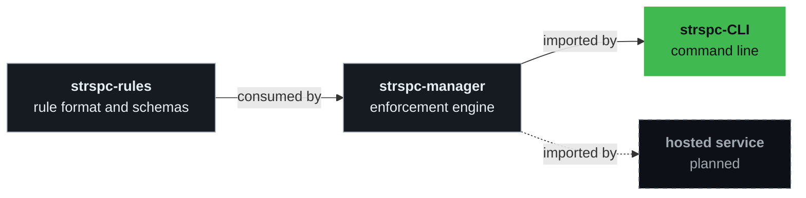

# Architecture, concepts and commands

Back to the [README](../README.md).

## Architecture

The [Rule Manager specification](https://github.com/SteerSpec/strspc-manager/blob/v1.44.0/docs/SPEC.md)
(cited below as SPEC, at v1.44.0, the manager version this CLI imports) is a draft that this CLI
follows. Its principles shape how the CLI works:

- **JSON is the source of truth.** Markdown is a rendered view.
- **Rules are immutable after Draft.** A change to a later rule is a new rule that supersedes it.
- **Enforcement is AI by default.** Rules are natural language read by an LLM; static checks are an
  optimization.
- **Severity belongs to the consumer.** A project's `fail_on` decides which violations block a merge.

Dependencies point one way, and releases land in the same order. Rule logic lives in the manager;
the CLI presents its results. [strspc-spec](https://github.com/SteerSpec/strspc-spec) holds the rules
that govern these tiers, and this repository owns the `dev.steerspec.cli` realm in
[`rules/`](../rules) (`CFG`, `CMD`, `CONV`), which pins `dev.steerspec.core` in
[`rules/realm.json`](../rules/realm.json).

| Command | Manager modules (SPEC §6.2) |
| ------- | --------------------------- |
| `strspc lint` | `rule-lint` |
| `strspc diff` | `rule-diff` |
| `strspc realm validate` | `realm-lint`, `rule-lint`, `remote` |
| `strspc render` | `rule-render`, plus `realm-resolve` for an entity that declares `inherits` |
| `strspc sync` | `rule-resolve`, `remote` |
| `strspc check` | `rule-resolve`, `realm-resolve`, `remote`, `rule-eval`, `eval-cache` |
| `strspc refs` | `rule-refs`, `rule-resolve`, `realm-resolve`, `remote` |
| `strspc realm dep upgrade` | `remote`, then the `realm validate` checks |

## Concepts

| Concept | What it is |
| ------- | ---------- |
| **Entity** | The unit of organization, one JSON file per top-level entity. Its EUID is 3 to 18 alphanumeric characters, unique within the Realm |
| **Rule** | A single-phrase behavioral constraint on an entity, such as `CFG-001` |
| **Rule set** | All rules of an entity, versioned as a unit, with a Blake3 hash of the file |
| **Note** | An annotation on a rule, such as a rationale or an example |
| **Realm** | A namespace of entities in a directory with a `realm.json` manifest and `_schema/`. Its ID is in reverse domain notation (`com.acme.app`) |
| **Configuration** | A project's `.strspc/config.yaml`: the rules it consumes and how they are enforced |

See SPEC [§2](https://github.com/SteerSpec/strspc-manager/blob/v1.44.0/docs/SPEC.md#2-data-model) for the
full data model.

## Commands

| Command | Description |
| ------- | ----------- |
| `strspc init` | Bootstrap `.strspc/config.yaml` and `.strspc/.gitignore` in a project |
| `strspc ci init` | Write the GitHub Actions workflow (and config) that runs SteerSpec in CI |
| `strspc lint` | Validate entity files against schema and rule constraints |
| `strspc diff` | Validate rule lifecycle transitions between a git ref and the working tree |
| `strspc check` | Evaluate a code diff against the rules in `.strspc/config.yaml` |
| `strspc refs` | Validate rule citations in Markdown and other text files |
| `strspc history` | Show how an entity's rules changed, from git |
| `strspc status` | Show the project's rule sources, rule counts and realm, without the network |
| `strspc doctor` | Diagnose the installation and the project, and suggest a fix for each problem |
| `strspc standards coverage` | Show how the rules map to the clauses of external standards |
| `strspc explain` | Explain a diagnostic code, or list all of them with `--list` |
| `strspc sync` | Resolve and cache the rule sources in `.strspc/config.yaml` |
| `strspc render` | Convert entity JSON files to Markdown or normalized JSON |
| `strspc realm init` | Scaffold a new Realm directory |
| `strspc realm add` | Add a new entity to a Realm |
| `strspc realm add-subrealm` | Scaffold a sub-realm inside an existing Realm |
| `strspc realm dep add\|remove\|list\|upgrade` | Manage Realm dependencies |
| `strspc realm validate` | Validate Realm structure and EUID uniqueness |
| `strspc realm standards add\|update\|remove\|list` | Declare the external standards a Realm cites |
| `strspc realm contributor add\|remove\|list` | Manage the contributors a Realm lists, which `--added-by` must name |
| `strspc realm rewrite-added-by` | Rewrite `added_by` values to contributor identifiers such as `github:alice` |
| `strspc rule add` | Add a Draft rule to an entity or sub-entity |
| `strspc rule update` | Edit the body of a Draft rule |
| `strspc rule promote` | Advance a rule D→P or P→I |
| `strspc rule retire` | Move a rule I→R or R→T |
| `strspc rule abandon` | Abandon a Draft rule (D→A) |
| `strspc rule supersede` | Create a Draft rule that supersedes a P, I or R rule |
| `strspc rule show` | Print rules by ID or entity, from the configured sources and their dependencies |
| `strspc rule history` | Show how a rule changed, from git |
| `strspc note add` | Attach a typed note to a rule |
| `strspc note update` | Revise a note in place; notes are never removed |
| `strspc entity add` | Add a sub-entity under an existing entity |
| `strspc entity rehash` | Recompute null or stale `rule_set.hash` values |
| `strspc entity standards add\|update\|remove\|list` | Declare the external standards an entity cites |
| `strspc completion` | Generate a shell completion script (bash, fish, powershell, zsh) |
| `strspc version` | Show version, commit and build info |

Run `strspc <command> --help` for every flag. Commands that edit rules take `--json`, and `--dir`
defaults to `./rules`.
