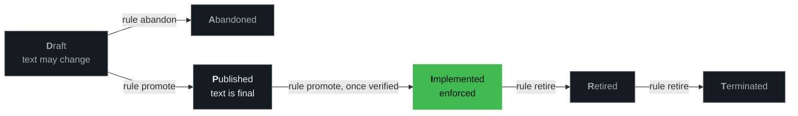

# Author rules

Back to the [README](../README.md).

Author rules through the CLI, which keeps versions and hashes valid. Don't edit entity JSON by hand.



Transitions are forward-only and no state may be skipped
([SPEC §3](https://github.com/SteerSpec/strspc-manager/blob/v1.47.1/docs/SPEC.md#3-rule-lifecycle)).
Every change bumps the rule set version: minor when a rule is promoted or retired, patch otherwise.

```bash
strspc rule add CFG --body "The CLI MUST write a config file." --added-by github:alice
strspc rule update CFG-001 --body "The CLI MUST write a YAML config file."     # Draft only
strspc rule promote CFG-001                                                    # D → P
strspc note add CFG-001 --type rationale --body "Why." --added-by github:alice
strspc note update CFG-001/01 --body "Corrected."
strspc entity add CFGIO --parent CFG --title "Config I/O"
strspc rule add CFG --sub-entity CFGIO --body "Writes MUST be atomic." --added-by github:alice
strspc entity rehash --all                                     # fix hashes after a bulk import
```

**Verifying before Implemented (experimental).** A rule should reach Implemented only once the code
complies. `rule verify` audits the current code against named rules, not a diff: it sends every
tracked file (or those matching `--path`, minus any `--exclude`) to the configured AI provider, with
numbered lines, and reports per rule `compliant` or `violated`, each with an explanation, a confidence
and the lines it rests on, or `not_applicable` or `unknown`. Something a rule requires that no file
has counts as a violation. It exits 1 when a rule is violated or couldn't be judged. Run `--dry-run`
first: it sizes the run without sending anything.

```bash
strspc rule verify CFG-002 --path src --dry-run   # files, tokens, requests
strspc rule verify CFG-002 --path src --effort high
strspc rule promote CFG-002 --path src            # verifies again, then P → I
```

**The promotion gate.** `rule promote` runs the same verification before it takes a rule from
Published to Implemented, with the same `--path`, `--exclude`, `--effort`, `--model` and
`--no-cache` flags, and refuses (exit 1) unless the code is judged `compliant` with a confidence of
at least `--min-confidence` (default 0.8). A violation refuses it, and so does a verdict that isn't
conclusive: `unknown`, `not_applicable` (no code the rule applies to was found), or one below the
threshold, such as a violation reported at 0.55. Models can be wrong about facts outside the code,
like whether a URL resolves, and a low confidence is the sign. A verdict that comes without an
explanation, a confidence or evidence is no judgement and is refused as such. The Claude provider
never caches an empty answer. In an audit in parts it asks again for that rule once, and otherwise
leaves the rule `unknown` with an RE002; in an audit that fits one request, an empty detail is
reported as an RE002 and the verdict stands, without its reasons. The refusal lists the verify run's diagnostics, such as RE002 for a request that failed. When verification can't run (no
`.strspc/config.yaml`, no AI provider, provider unavailable, or the rule isn't in the configured
sources) the promotion is refused with verify's exit code. So is a rule whose copy under `--dir`
differs from the one in the configured sources, since the verdict wouldn't be about it. `--skip-verify` promotes without
verifying, for a rule a person has checked or a project without an AI provider. Draft → Published
is never verified.

**The verify record.** A promotion to Implemented writes `.strspc/verified/<RULE-ID>.json` in
`--project`, to commit with the change to `rules/`, so the pull request carries what the promotion
rested on: the rule's revision and a hash of its text, the files read (scope, count and a hash of
their content), the provider, model, effort and audit prompt, the threshold, and the verdict with
its explanation, confidence and evidence. A promotion with `--skip-verify` is recorded as skipped,
with no verdict. A project without `.strspc/` gets no record. If the rule is promoted but its
record can't be written, the command fails with exit 1 and says so; the rule stays promoted.

The files read stand for the whole code: `--path` and `--exclude` narrow what counts as existing.
Excluding tests (`--exclude '**/*_test.go'`) is fine for a rule about production code, but makes a rule
such as "every command has a test" fail.

A tree too large for one request is read in parts that collect what each file holds for each rule;
every rule is then judged on all of it, so a rule spanning files is judged on the whole tree. What
each file holds is kept in `.strspc/cache.db` (`--no-cache` skips it), so a rerun reads only the
files that changed. An audit that fits one request isn't cached.

As with `strspc check`, files under `.strspc/` and `rules/` are never read, even when `--path` matches
them: the configuration and the project's own rule files are covered by `lint` and `diff`. A rule
about those files can't be verified this way. Untracked, deleted, symlinked and binary files aren't
read either; the report lists those it skipped. Tracked in
[#291](https://github.com/SteerSpec/strspc-CLI/issues/291).

**Sub-entities.** Rule commands accept a sub-entity EUID anywhere a top-level EUID is accepted: the
CLI scans `sub_entities[]` of every entity file under `--dir` and refreshes the parent hash.

**Symbolic links.** Commands never write through an entity file that is a symbolic link, since its
target may lie outside `--dir`: rule, note and entity commands refuse it, and `entity rehash --all`
and `realm rewrite-added-by` list it as skipped. Edit the target where it lives. Commands that only
read, such as `entity standards list`, follow the link.

**Superseding.** Rules that have left Draft are immutable, so `rule supersede` creates a Draft that
replaces them. It leaves the original unchanged: when the new rule reaches Implemented, the old one
must be Retired, or `strspc diff` warns (`RD006`). `rule retire` moves a rule from Implemented to
Retired, so promote a Published rule first. A rule that's already Retired needs nothing.

**Notes.** Types are `rationale`, `example`, `counter_example`, `reference`, `applies_to`, `changelog`,
`clarification`, `deprecation_notice`, `supersedes`, `extends`, `related`, `standard` and `structured`. A
note can be revised but never removed. `changelog`, `supersedes`, `extends` and `related` notes can't change
once added.

A `standard` note maps its rule to one clause of a declared standard (`<standard-id>:<clause>`). It can be
added, revised, or retyped to `reference` and back in any rule state, without changing the rule's revision
(NTE-017, NTE-018); retyping it to `reference` is how a mapping is withdrawn (NTE-019).

A `structured` note holds the machine-readable form of its rule, as `<format>:<payload>` with neither
part blank (NTE-037), such as `json:{"max_retries": 3}`. SteerSpec doesn't interpret the payload
(NTE-039). A rule holds at most one (NTE-040), and it is frozen once the rule leaves Draft: it can't be
added, revised or retyped after that (NTE-041, which `strspc check` reports in a diff as RD025).

```bash
strspc note add CFG-001 --type structured --body 'json:{"max_retries": 3}' --added-by github:alice
```

Each of these two types needs a core pin whose entity schema accepts it: `standard` needs
`dev.steerspec.core` 1.15.0 or later, and `structured` 1.23.0 or later. Under an older pin, `note add` and
`note update` refuse to write a note of that type, whether it is new, retyped or only revised, and say
how to upgrade the pin.

**Contributors.** `--added-by` takes a contributor identifier, `<idp>:<login>` with `github` as the
only provider (CTRB-001, CTRB-002). When the Realm lists `realm.contributors`, the value must name
one of them (CTRB-005), and a sub-realm uses its parent's list (CTRB-006). An `@handle` or an email
address is refused; `realm rewrite-added-by` migrates files that still hold them, and `strspc lint`
reports any left (`RL032`, an error). `strspc diff` fails on a new rule or note by someone the Realm
doesn't list (`RD023`, an error).

`realm contributor` edits the list, so realm.json is never edited by hand. A sub-realm's list is its
parent's, so it is edited there:

```bash
strspc realm contributor add github:alice --github-id 1234567 --email alice@example.com
strspc realm contributor list
strspc realm contributor remove github:alice
```

`--github-id` records the account's numeric ID, which survives a rename (CTRB-008):
`gh api users/<login> --jq .id` prints it. `add` needs `dev.steerspec.core` 1.16.0 or later.

Without `--added-by`, `rule add`, `note add` and `rule supersede` use `$STRSPC_ADDED_BY`, then the
listed contributor whose email is your `git config user.email`, and print which one they used. The
value is checked like the flag's, before anything is written.

`realm rewrite-added-by` migrates existing values, with a patch bump for each changed file:

```bash
strspc realm rewrite-added-by --github-handles --dry-run         # preview @alice → github:alice
strspc realm rewrite-added-by --github-handles --map alice@example.com=github:alice
```

**Inheritance.** An entity can inherit another entity's rule set, in the same Realm or in a declared
dependency, and a rule can override one inherited rule for that entity:

```bash
strspc realm add SAVACCT --title "Savings Account" --inherits dev.globalbank.core:ACCT
strspc rule add SAVACCT --body "Withdrawals MUST be capped." --added-by github:alice \
  --overrides dev.globalbank.core:ACCT-005 # strspc-refs: ignore
```

`entity add` also takes `--inherits`, and `rule supersede` takes `--overrides` to keep an override in
force on the replacement rule.

## Realms and dependencies

`strspc realm init` creates `realm.json` and vendors the schemas in `_schema/`
([SPEC §2.8](https://github.com/SteerSpec/strspc-manager/blob/v1.47.1/docs/SPEC.md#28-realm)). Non-core
realms should depend on `dev.steerspec.core`, as in the [quick start](../README.md#quick-start).

The schemas are copied unchanged from the `dev.steerspec.core` release tag in `strspc-rules`: the
`--core-version` you pass, else the core dependency's version, else the latest release. Since core
release 1.20.0 each file carries its release as a top-level `x-steerspec-core-version`. Copies of
older releases have no such field. `realm init` refuses a core dependency whose `github://` source tag
differs from its version, and a `--core-version` that differs from the dependency.

```bash
strspc realm dep add com.acme.shared@1.0.0=../shared
strspc realm dep list
strspc realm dep remove com.acme.shared
strspc realm add-subrealm --parent-dir rules --dir rules/sync --id com.acme.app.sync --title "Sync"
```

A sub-realm inherits its parent's dependencies unless you pass `--no-inherit-deps`. `add-subrealm`
doesn't declare it in the parent: add the directory name to `sub_realms` in the parent's `realm.json`,
or `realm validate --recursive` skips it.

**Keep dependencies current.** Dependabot and Renovate can't read `realm.json`, so a pinned dependency
drifts silently. `strspc realm dep upgrade` moves each `github://` dependency pinned to a release tag
to the latest release of its repository, rewrites `version` and the `@vX.Y.Z` in `source`, then
validates the realm (strict, recursive).

```bash
strspc realm dep upgrade --check    # exit 1 if an upgrade is available; writes nothing
strspc realm dep upgrade            # upgrade every dependency
strspc realm dep upgrade dev.steerspec.core --to X.Y.Z
```

When `dev.steerspec.core` is upgraded, the `_schema/*.json` files that differ from the new release's
copies are replaced by them, so the realm doesn't trip RM015 (schema drift). This covers sub-realms
that inherit the pin; one that pins its own core is left alone. Files the core release doesn't hold
are left alone too. If the new version breaks the realm, `realm.json` and the schema files are
restored and the command exits non-zero.
Dependencies are never downgraded. Sources that aren't `github://` references, and those on `@latest`,
a branch or a commit SHA, are skipped. See [GitHub sources](reference.md#github-sources) for private
repositories.

**Manifest hash.** Since core 1.21.0, `realm.json` may carry a `hash`: the Blake3 hash of the manifest
without that field (RLMMNFST-013, a Draft rule), which `realm validate` checks (RM025). Every `realm`
command that rewrites a manifest with a hash recomputes it (RLMMNFST-014). `realm init` writes none.
After editing `realm.json` by hand or by a script, such as a release bump or a pin change,
`strspc realm rehash` adds the hash or refreshes it, in the realm and each sub-realm it lists. Adding
one needs a `dev.steerspec.core` pin of 1.21.0 or later.

```bash
strspc realm rehash                 # add or refresh the hash of ./rules/realm.json and its sub-realms
strspc realm rehash --json
```
